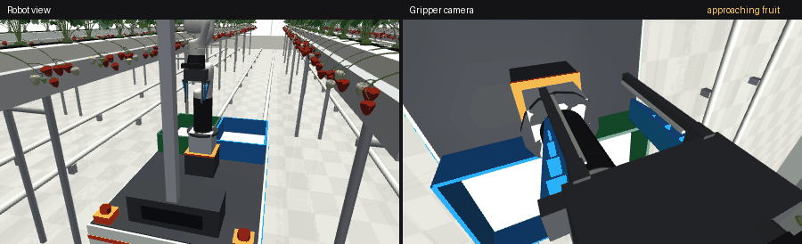
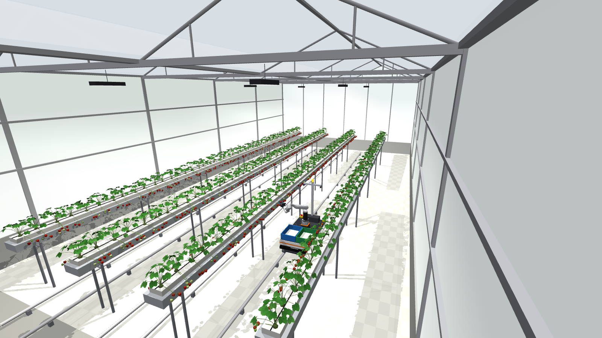
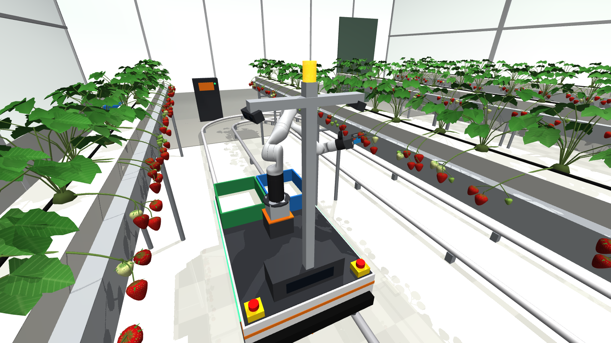
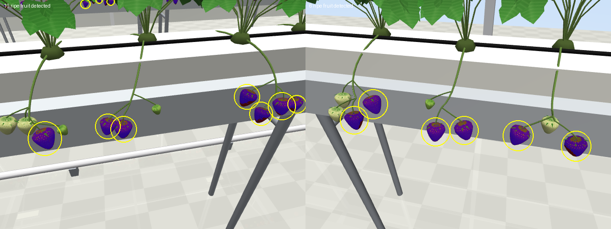
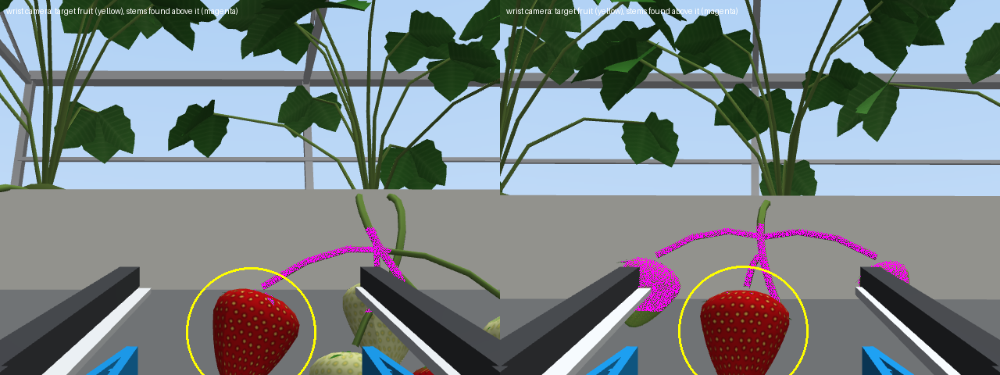

# 🍓 Strawberry Harvest Sim: Autonomous Harvesting Robot in a Simulated Greenhouse

**A MuJoCo simulation of a rail-guided strawberry harvester that finds ripe fruit with its own cameras, picks each one with a soft force-limited gripper, cuts the stem, and fills crates.**

<p align="center">
  
  
  
  
  
  
</p>

A cart drives on pipe rails between tabletop strawberry rows. At each stop, two mast cameras find the ripe fruit, a Kinova Gen3 arm reaches in, and the wrist camera re-measures the fruit before the grasp. Soft fin-ray fingers close with a 1 N force limit, and a sliding knife cuts the stem. The fruit is lowered into a crate on the cart, and full crates are handed off at the end of the rows. Every pick is measured: grip force, bruising, missed cuts, fruit dropped by accident, and cycle time.

---

## 🎬 Simulator demo



**Left:** the whole robot, seen from behind the cart. **Right:** a camera mounted on the end effector, so you can watch each grasp up close.

| The greenhouse | The harvester |
| --- | --- |
|  |  |

## 🎯 Goal of the work

The goal is a **watchable simulation of a complete harvesting system**, not just a grasping demo. It covers:

- **Navigation:** A rail-guided cart that drives every aisle and switches aisles at the headland.
- **Perception:** Finding ripe fruit from camera images only, without being told where they are.
- **Manipulation:** planning an approach for each fruit and picking it without damaging it.
- **Soft-fruit handling:** A force-limited soft gripper and a stem cut, so the fruit is never pulled or squeezed hard.
- **Logistics:** filling crates and handing them off.
- **Measurement:** Honest statistics for every mission, compared against a baseline that knows the true fruit positions.

## ✨ Features

| Feature | What the simulation does |
| --- | --- |
| Procedural greenhouse | Builds walls, roof, lamps, 4 tabletop rows, 192 plants and 1,326 strawberries (70 % ripe) from one script. |
| Connected rail network | Pipe rails in 3 aisles, joined by curves and a cross-rail at the headland. |
| Two-bogie rail cart | Swivelling bogies follow the curves; the cart reverses like a train instead of turning around. |
| Camera-based detection | Mast cameras segment ripe red pixels, split touching fruit, and back-project blobs to 3-D with depth. |
| Multi-view fruit map | Detections from many images are fused into one world map, so each fruit is picked once. |
| Per-fruit IK planning | Tries 5 approach angles per fruit, avoids neighbours between the fingers, and solves IK on a small robot-only model. |
| Wrist-camera check | Re-measures each fruit from close range before the grasp and skips it if it is not there. |
| Soft force-limited grip | Fin-ray fingers close with a 1 N per finger limit; the peak squeeze force is recorded for every fruit. |
| Physical stem cut | The knife only frees the fruit if its own stem crosses the knife window; a neighbour's stem in the window is cut too and that fruit drops. |
| Re-grip on a missed cut | If the stem was outside the knife window, the robot tries once more from another angle. |
| Bruise model | Each fruit has its own firmness; fully ripe fruit are softer. Squeezing above it counts as damage. |
| Crates and hand-off | Fruit are placed in 4 layers in the crate on that side; full crates are stacked at the headland. |
| Second look | The wrist camera scans for fruit the mast cameras could not see, and those are picked too. |
| Mission report | Per-pick CSV and a JSON summary for every run, in camera mode or known-position baseline mode. |

## 🧰 What we used

| Component | Technology | Role in this project |
| --- | --- | --- |
| Physics and rendering | MuJoCo 4.0 | Robot dynamics, contacts between fingers and fruit, and all camera images (colour and depth). |
| Robot arm | Kinova Gen3 7-DoF (MuJoCo Menagerie model) | The picking arm, with gravity compensation, position control and Gen3 joint speed limits. |
| Application and controller | Python | Scene generation, mission control, planning, fruit bookkeeping and reporting. |
| Image and geometry processing | NumPy + SciPy | Pixel segmentation, blob labelling, k-means splitting, back-projection and IK maths. |
| Viewer | MuJoCo passive viewer | Interactive 3-D view with live status and statistics overlay. |

## 🧩 How it works

| What the mast cameras detect | What the wrist camera sees before a grasp |
| --- | --- |
|  |  |

1. **Scan.** At every stop, and twice while driving to it, the side-looking mast cameras take colour and depth images. Ripe red pixels become blobs, and the blobs become 3-D fruit positions in a shared fruit map.
2. **Plan.** For every mapped fruit within 0.47 m of the arm, the planner tries 5 approach angles, avoids angles where a neighbouring fruit would sit between the fingers, and solves IK for a pre-grasp pose, a straight approach and the grasp.
3. **Check.** At the pre-grasp pose, the wrist camera re-measures the fruit and the grasp is corrected. If the fruit is not there, it is skipped.
4. **Grip.** The fingers close with a 1 N force limit. A neighbour touched by one finger is pushed aside and swings back.
5. **Cut.** The knife cuts every stem crossing its window. If the fruit's own stem missed, the robot re-grips once from another angle. A neighbour's stem in the window is cut too, and that fruit falls to the floor.
6. **Crate.** The fruit is lowered to the next free slot in the crate on that side and released. After each aisle, the full crates are handed off at the headland.
7. **Second look.** The wrist camera checks each side of the pick window for fruit the mast cameras missed.

**Autonomy scope:** the cart follows a known rail route. Fruit positions are not given to the robot in camera mode; it finds them from images. Camera poses come from the simulator.

## 🏠 Included simulation environment

| Property | Current scene |
| --- | --- |
| Greenhouse | Enclosed, about 15 × 7 m, with knee walls, film walls and roof, frame, door and lamps |
| Growing system | 4 tabletop gutter rows, 12 m long, 1.5 m apart, gutter top at 1.0 m |
| Plants and fruit | 192 plants and 1,326 strawberries, 927 ripe (70 %) and 399 unripe, hanging on the aisle sides |
| Track | 3 pipe-rail aisles (0.55 m gauge) joined by 0.75 m radius curves and a headland cross-rail |
| Robot | 1.10 × 0.66 m cart, lift column, Kinova Gen3, two mast RGB-D cameras, two crates (187 fruit each) |
| Headland props | Charging dock, stack of empty crates, and a hand-off area for full crates |


## 📁 Project structure

```text
Strawberry-Harvest-Sim/
├── build_scene.py               # Builds the greenhouse, plants, fruit and robot into scene/
├── layout.py                    # Rows, lengths, ripe fraction, rail network and robot route
├── meshes.py                    # Procedural leaf, strawberry and calyx meshes and textures
├── robot.py                     # Cart, bogies, lift, cameras, crates, Gen3, gripper, actuators, IK
├── perception.py                # Ripe-fruit detection, fruit map, wrist-camera check
├── harvester.py                 # Mission: driving, planning, grip, cut, crates, bruise model, statistics
├── view_scene.py                # Interactive viewer with live status and statistics
├── run_harvest.py               # Headless mission, report and demo GIF
├── render_preview.py            # Still images from the scene cameras
├── docs/DESIGN.md               # Design decisions, build order and what was built
├── third_party/kinova_gen3/     # Kinova Gen3 model from MuJoCo Menagerie (BSD licence)
├── images/                      # Demo GIF and README images
└── requirements.txt             # Python dependencies
```


## 📈 Our results (full mission, 3 aisles)

| Metric | Cameras (`run_harvest.py`) | Known positions (`--oracle`) |
| --- | --- | --- |
| Ripe fruit picked | **818 / 927 (88 %)** | 851 / 927 (92 %) |
| Bruised (squeeze force above the fruit's firmness) | 10 (1.2 %) | 14 (1.6 %) |
| Unripe fruit picked | 0 | 0 |
| Stem not cut after re-grip | 35 | 6 |
| Neighbour stems cut, fruit dropped | 71 (33 ripe) | 67 (33 ripe) |
| Ripe fruit left on the plants | 76 | 43 |
| Average cycle time | 8.8 s per fruit (about 330 per hour) | 9.1 s (about 370 per hour) |

**Cameras** is the normal mode: the robot finds every fruit with its own cameras. **Known positions** (the `--oracle` option) skips the cameras and gives the robot the true fruit positions from the scene file. No real robot could do that, so it serves as a best-case comparison. Fruit per hour counts the whole mission, including driving, scanning and crate swaps, which is why camera mode has a shorter cycle time but fewer fruit per hour.

Camera detection over the whole mission: 921 real ripe fruit mapped, 0 unripe fruit, and 13 duplicates or ghosts. Using cameras instead of perfect knowledge costs about 4 percentage points of harvest, mostly because a few millimetres of aim error can leave the stem outside the knife window.

## ⚙️ Setup on Windows

**Prerequisites:** Python 3.14 and Git. Tested with MuJoCo 4.0.1, NumPy 2.4, SciPy 1.18 and Pillow 12.2. Integrated graphics are enough; shadows are off by default to keep the viewer fast.

Clone the repository and open the project folder:

```powershell
git clone https://github.com/md-jawad-117/Strawberry-Harvest-Sim.git
cd Strawberry-Harvest-Sim
```

Create an environment and install the dependencies:

```powershell
py -3.14 -m venv .venv
.\.venv\Scripts\python.exe -m pip install -r requirements.txt
```

Generate the scene once (about 1 minute):

```powershell
.\.venv\Scripts\python.exe build_scene.py
```

## ▶️ Run the harvester

Watch the full mission in the interactive viewer:

```powershell
.\.venv\Scripts\python.exe view_scene.py --speed 2
```

## 🧪 Test it yourself

There are two ways to reproduce the results without a window. Both run the camera mode and the known-position mode one after the other and print a comparison table at the end. If the `scene/` folder is missing, it is built first.

**Quick test (about 2 minutes).** Aisle 0 only, stopped after 5 simulated minutes. Good for checking that everything works. Results go to `results_quick/`.

```powershell
.\.venv\Scripts\python.exe run_harvest.py --quick
```

**Full run (about 70 minutes).** Rebuilds the scene from scratch, then runs the whole mission over all 3 aisles in both modes. Results go to `results/`, so you can compare your numbers with the table above.

```powershell
.\.venv\Scripts\python.exe run_harvest.py --full
```

The scene is generated from a fixed seed, so a full run gives the same fruit layout as our results. Small differences in the counts are possible between machines.


## 📊 Outputs and configuration

| Location | Contents |
| --- | --- |
| `results/summary_vision.json` (created by a run) | Mission summary in camera mode: picked, bruised, misses, drops, cycle time, detection counts |
| `results/summary_oracle.json` | The same summary for the known-position baseline |
| `results/picks_<mode>.csv` | One row per pick attempt: target, outcome, fruit id, peak force, cycle time, wrist correction |
| `layout.py` (`CONFIG`) | Number of rows, row length, spacing, ripe fraction, random seed |
| `harvester.py` (top constants) | Grip force, drive speeds, pick window, approach angles, crate layout |
| `robot.py` (top constants) | Cart dimensions, lift height, finger opening, knife window |

Run `build_scene.py` again after changing `layout.py` or the robot geometry in `robot.py`.

## 🔬 Current scope and limitations

- **Simulation prototype:** the fruit, plants and lighting are procedural. Performance with real cameras and real plants has not been established.
- **Simplified fruit physics:** fruit are kinematic (mocap) bodies. A fruit pushed by a finger swings aside with a simple spring model, and stems are polylines used for the cut test rather than simulated flexible stems.
- **Colour-based detection:** ripe fruit are found by colour and depth. This works in the simulated lighting but would need a learned detector for real greenhouse conditions.
- **Bruise model:** damage is a threshold on peak squeeze force with a random firmness per fruit, not a tissue model.
- **Known route and poses:** the cart follows a fixed rail route, and camera poses come from the simulator. There is no SLAM or localisation error.
- **Cluster losses:** about 70 fruit per mission fall when the knife also cuts a neighbour's stem.

## 🚀 Future work

- **Stem-aware cutting:** most lost fruit come from the knife catching a neighbour's stem, or missing the fruit's own stem, in tight clusters. The wrist camera could locate the stems just above the target in 3-D and the planner could choose the approach angle that puts only the fruit's own stem in the knife window. A second wrist view from another angle, or a final stem check just before the knife closes, would make this more reliable.
- **Learned fruit detector:** replace the colour threshold with a segmentation model trained on synthetic and real greenhouse images.
- **Localisation:** estimate the cart and camera poses from sensors instead of reading them from the simulator.
- **Hardware:** connect the same mission software to a real arm and cart, which would turn this simulation into a true digital twin.

## 📄 License

See [LICENSE](LICENSE). The Kinova Gen3 model in `third_party/kinova_gen3/` comes from MuJoCo Menagerie and keeps its own licence file.
